<div align="center">

# Hey 👋 What's up? I'm Álvaro (`@AlvaDex`)

**Software Design & Networks Student | Cybersecurity & Blue Team Enthusiast | Linux Tinkerer**

[](https://www.linkedin.com/in/aalvarez-p/)
[](https://dev.to/alvadex)

</div>

---

### 🧑‍💻 `whoami`

```yaml
role: "Software Developer & Aspiring SOC / Blue Team Analyst"
currently_building: "🛡️ Vigía — Lightweight attack detection & purple team validation platform"
focus_areas:
  - "Threat Detection & Log Analysis (MITRE ATT&CK, YAML / Sigma-style rules)"
  - "Full-Stack Web Engineering & REST APIs"
  - "Custom Linux Environments & Automation"
fun_fact: "I break things in isolated Docker labs just to prove my detection rules actually catch them."
```

---

### 🧰 Tech Stack & Tools

<div align="center">
  
</div>

---

### 📊 GitHub Stats & Trophies

<div align="center">
  
  
</div>

<br/>

<div align="center">
  
</div>

---

### 👾 Contribution Activity

<div align="center">
  <picture>
    <source media="(prefers-color-scheme: dark)" srcset="https://raw.githubusercontent.com/AlvaDex/AlvaDex/pacman-output/pacman-contribution-graph-dark.svg?game=pacman">
    <source media="(prefers-color-scheme: light)" srcset="https://raw.githubusercontent.com/AlvaDex/AlvaDex/pacman-output/pacman-contribution-graph.svg?game=pacman">
    
  </picture>
</div>
